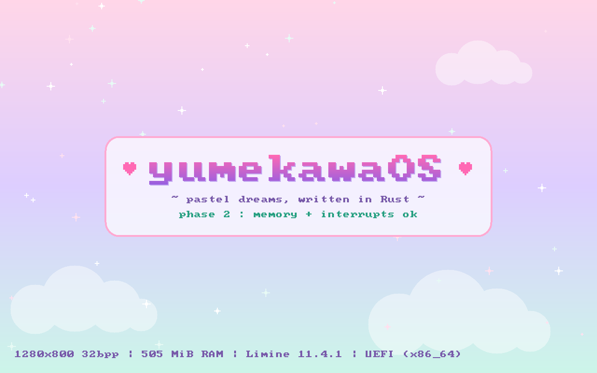
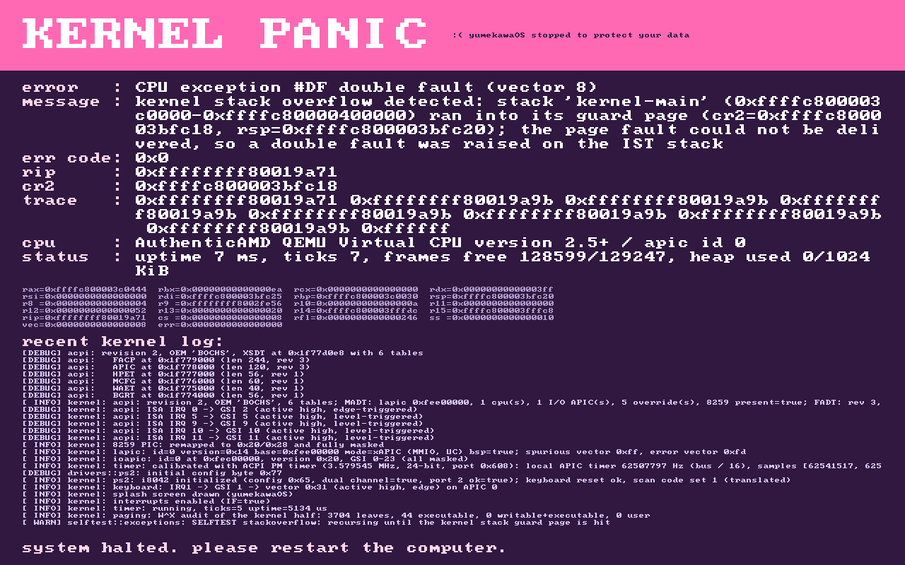

# yumekawaOS

yumekawaOS は、x86_64 UEFI PC を対象とした Rust 製の独立した GUI オペレーティングシステムです。
ゆめかわいい世界観のデスクトップ環境を目指しています。設計要件は [docs/requirements.md](docs/requirements.md) を参照してください(本書が最優先の仕様です)。

## 現在の状態: Phase 2 (Memory / Interrupt)

| 項目 | 状態 |
| --- | --- |
| Rust プロジェクト (Cargo workspace, `x86_64-unknown-none`, higher-half カーネル) | 実装済み (Phase 1) |
| UEFI 起動 (Limine 11.4.1) / ハイブリッド ISO / CD-ROM・USB 起動の自動テスト | 実装済み (Phase 1) |
| COM1 シリアルへのカーネルログ (TRACE〜FATAL) + 直近ログのリングバッファ | 実装済み |
| 自前の GDT / TSS (IST: #DF・NMI・#MC) / IDT (256 ベクタ) | 実装済み |
| CPU 保護機能: CR0.WP, NX, Global ページ, SMEP / SMAP / UMIP (CPU が対応していれば) | 実装済み |
| 物理フレームアロケータ (ビットマップ, 連続確保, 二重解放検出, bootloader-reclaimable の回収) | 実装済み |
| カーネル自身のページテーブル (W^X, HHDM は 1GiB/2MiB ページ, framebuffer は WC, MMIO は UC) | 実装済み |
| ページマッパ API (map / unmap / translate / protect, プロセス用アドレス空間の雛形) | 実装済み |
| カーネルヒープ (`#[global_allocator]`, 自動拡張) | 実装済み |
| ガードページ付きカーネルスタック (オーバーフローは #DF で検出) | 実装済み |
| CPU 例外 0〜31 (#BP からの復帰、#PF/#GP/#DF/#UD/#DE の詳細ログ) | 実装済み |
| Kernel Panic 画面 (種別・エラーコード・CPU・RIP・レジスタ・バックトレース・直近ログ) | 実装済み (見た目の作り込みは Phase 3/4) |
| ACPI (RSDP/XSDT/MADT/FADT, チェックサム検証) / Local APIC / I/O APIC / 8259 の無効化 | 実装済み |
| Local APIC タイマ (ACPI PM timer / PIT で校正, 1000Hz, uptime API) | 実装済み |
| PS/2 キーボード (i8042 初期化, IRQ1, スキャンコード set 1 の受信とログ) | 実装済み (キーマップ・イベント API は Phase 3) |
| マウス, GUI, タスク切り替え, システムコール | 未実装 (Phase 3 以降) |
| 実機での起動 | 未確認 (Phase 11) |



Kernel Panic 画面の例 (`selftest=stackoverflow`: カーネルスタックのガードページ → #DF):



## クイックスタート

前提ツール (Ubuntu / Debian / WSL2 の例):

```sh
sudo apt install qemu-system-x86 ovmf xorriso git python3
rustup toolchain install 1.97.0
rustup target add x86_64-unknown-none --toolchain 1.97.0   # rustup default 1.97.0 等で選択
```

ビルド・ISO 生成・起動:

```sh
scripts/build.sh          # build/kernel   (release。--debug で debug ビルド)
scripts/make_iso.sh       # build/yumekawaOS.iso, build/bootloader/
scripts/run.sh            # QEMU + OVMF で起動 (シリアルは端末へ)
scripts/run.sh --usb      # ISO を USB メモリとして起動
scripts/test-boot.sh      # ヘッドレス自動テスト (起動 / パニック / メモリ / 例外 / タイマ / キーボード / アイドル)
```

`rustup target add` が使えない環境(ネットワーク制限のあるサンドボックス等)では、
先に `scripts/sandbox-toolchain.sh` を一度実行します。詳細は [docs/build.md](docs/build.md)。

### USB メモリから実機で起動する

`build/yumekawaOS.iso` は UEFI 用のハイブリッド ISO です。USB メモリへそのまま書き込めます
(**書き込み先のデバイスの内容はすべて消えます**)。

```sh
sudo dd if=build/yumekawaOS.iso of=/dev/sdX bs=4M conv=fsync status=progress
```

Windows では Rufus の「DD イメージモード」で書き込んでください。
PC の UEFI ブートメニューから USB を選びます。Secure Boot は無効にしてください(Limine は署名されていません)。
起動ログは COM1 (115200 baud 8N1) に出力されます。

## ディレクトリ構成

```text
yumekawaos/
├── Cargo.toml / Cargo.lock    Cargo workspace (members: kernel)
├── .cargo/config.toml         既定ターゲットとカーネル用 rustflags
├── kernel/                    カーネル (no_std / no_main)
│   ├── linker.ld              higher-half (0xffffffff80000000) 配置
│   ├── build.rs               リンカスクリプト指定・割り込みスタブ生成
│   └── src/
│       ├── main.rs            エントリポイント kmain・初期化順序・アイドルループ
│       ├── arch/x86_64/       CPU 命令・制御レジスタ・Port I/O・GDT/TSS・IDT・割り込み入口・プローブ
│       ├── boot/              Limine ブート情報 → safe な BootInfo (カーネル内へコピー)
│       ├── memory/            フレーム・ページテーブル・HHDM・ヒープ・スタック・MMIO
│       ├── interrupts/        ディスパッチ・ベクタ割り当て・例外
│       ├── acpi/              ACPI テーブル (MADT / FADT)
│       ├── drivers/           serial / 8259 PIC / APIC / PIT / PM timer / PS/2
│       ├── time/              タイマ校正・tick・uptime
│       ├── graphics/          framebuffer・display (所有)・フォント・スプラッシュ・パニック画面
│       ├── log.rs             カーネルログ
│       ├── panic.rs           Kernel Panic
│       ├── selftest/          起動時セルフテスト (cmdline selftest=...)
│       ├── sync/              IrqSpinLock / Once / SpscRing
│       └── fmtbuf.rs          ヒープ無しの文字列バッファ
├── boot/limine.conf           Limine 設定
├── scripts/                   ビルド・ISO・実行・テスト
└── docs/                      要件書・設計・ビルド手順・依存関係
```

GUI (`gui/`)、ユーザーアプリ (`user/`)、アセット (`assets/`) などのディレクトリは、
実装するフェーズで追加します(空のディレクトリで「あるように見せる」ことはしません)。

## ドキュメント

- [docs/requirements.md](docs/requirements.md) — 設計要件書
- [docs/architecture.md](docs/architecture.md) — 初期化順序、モジュール構成、ロック規約、unsafe の所在、Phase 3 への引き継ぎ
- [docs/memory.md](docs/memory.md) — 仮想アドレス空間レイアウト、ページテーブル、フレームアロケータ、ヒープ、スタック
- [docs/interrupts.md](docs/interrupts.md) — GDT/IDT、ベクタ割り当て、例外、Kernel Panic、APIC、タイマ、キーボード
- [docs/build.md](docs/build.md) — ビルド手順 (通常環境 / サンドボックス)、再現性
- [docs/dependencies.md](docs/dependencies.md) — 外部依存の一覧 (§43.4)

## ライセンス

yumekawaOS は以下のいずれかを選択できるデュアルライセンスです。

- MIT License ([LICENSE-MIT](LICENSE-MIT))
- Apache License, Version 2.0 ([LICENSE-APACHE](LICENSE-APACHE))

Copyright (c) yumekawaOS contributors.
ISO に同梱される Limine は BSD-2-Clause です(ISO 内 `boot/limine/LICENSE.limine`)。
依存ライブラリのライセンスは [docs/dependencies.md](docs/dependencies.md) を参照してください。
