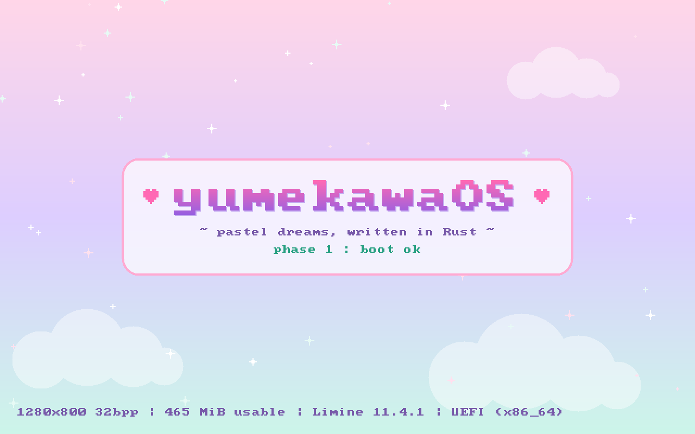

# yumekawaOS

yumekawaOS は、x86_64 UEFI PC を対象とした Rust 製の独立した GUI オペレーティングシステムです。
ゆめかわいい世界観のデスクトップ環境を目指しています。設計要件は [docs/requirements.md](docs/requirements.md) を参照してください(本書が最優先の仕様です)。

## 現在の状態: Phase 1 (Boot)

| 項目 | 状態 |
| --- | --- |
| Rust プロジェクト (Cargo workspace, `x86_64-unknown-none`, higher-half カーネル) | 実装済み |
| UEFI 起動 (ブートローダ: Limine 11.4.1, Limine boot protocol) | 実装済み |
| ブート情報 (framebuffer / メモリマップ / HHDM 等) の safe API | 実装済み |
| COM1 シリアルへのカーネルログ (TRACE〜FATAL) | 実装済み |
| framebuffer へのスプラッシュ表示 (32bpp のみ。他は明示的にエラー) | 実装済み |
| パニックハンドラ (シリアルへ場所とメッセージ、割り込み無効で停止) | 実装済み |
| UEFI 起動可能なハイブリッド ISO (`build/yumekawaOS.iso`) の生成 | 実装済み |
| QEMU (OVMF) での CD-ROM 起動 / USB ストレージ起動の自動テスト | 実装済み |
| 実機 USB 起動 | ISO は USB へそのまま書き込める構成。実機での確認は未実施 (Phase 11) |

メモリ管理・割り込み・入力・GUI などは Phase 2 以降で実装します(§34)。



## クイックスタート

前提ツール (Ubuntu / Debian / WSL2 の例):

```sh
sudo apt install qemu-system-x86 ovmf xorriso git python3
rustup toolchain install 1.97.0
rustup target add x86_64-unknown-none --toolchain 1.97.0   # rustup default 1.97.0 等で選択
```

ビルド・ISO 生成・起動:

```sh
scripts/build.sh          # build/kernel   (release。--debug で debug ビルド)
scripts/make_iso.sh       # build/yumekawaOS.iso, build/bootloader/
scripts/run.sh            # QEMU + OVMF で起動 (シリアルは端末へ)
scripts/run.sh --usb      # ISO を USB メモリとして起動
scripts/test-boot.sh      # ヘッドレス自動テスト (CD-ROM / USB / パニック)
```

`rustup target add` が使えない環境(ネットワーク制限のあるサンドボックス等)では、
先に `scripts/sandbox-toolchain.sh` を一度実行します。詳細は [docs/build.md](docs/build.md)。

### USB メモリから実機で起動する

`build/yumekawaOS.iso` は UEFI 用のハイブリッド ISO です。USB メモリへそのまま書き込めます
(**書き込み先のデバイスの内容はすべて消えます**)。

```sh
sudo dd if=build/yumekawaOS.iso of=/dev/sdX bs=4M conv=fsync status=progress
```

Windows では Rufus の「DD イメージモード」で書き込んでください。
PC の UEFI ブートメニューから USB を選びます。Secure Boot は無効にしてください(Limine は署名されていません)。
起動ログは COM1 (115200 baud 8N1) に出力されます。

## ディレクトリ構成

```text
yumekawaos/
├── Cargo.toml / Cargo.lock    Cargo workspace (members: kernel)
├── .cargo/config.toml         既定ターゲットとカーネル用 rustflags
├── kernel/                    カーネル (no_std / no_main)
│   ├── linker.ld              higher-half (0xffffffff80000000) 配置
│   ├── build.rs               リンカスクリプト指定
│   └── src/
│       ├── main.rs            エントリポイント kmain
│       ├── arch/x86_64/       CPU 命令・Port I/O
│       ├── boot/              Limine ブート情報 → safe な BootInfo
│       ├── drivers/serial.rs  COM1 16550 UART
│       ├── graphics/          framebuffer・最小フォント・スプラッシュ
│       ├── log.rs             カーネルログ
│       ├── panic.rs           パニックハンドラ
│       ├── sync/              スピンロック
│       └── fmtbuf.rs          ヒープ無しの文字列バッファ
├── boot/limine.conf           Limine 設定
├── scripts/                   ビルド・ISO・実行・テスト
└── docs/                      要件書・設計・ビルド手順・依存関係
```

GUI (`gui/`)、ユーザーアプリ (`user/`)、アセット (`assets/`) などのディレクトリは、
実装するフェーズで追加します(空のディレクトリで「あるように見せる」ことはしません)。

## ドキュメント

- [docs/requirements.md](docs/requirements.md) — 設計要件書
- [docs/architecture.md](docs/architecture.md) — ブートフロー、メモリレイアウト、モジュール境界
- [docs/build.md](docs/build.md) — ビルド手順 (通常環境 / サンドボックス)、再現性
- [docs/dependencies.md](docs/dependencies.md) — 外部依存の一覧 (§43.4)

## ライセンス

yumekawaOS は以下のいずれかを選択できるデュアルライセンスです。

- MIT License ([LICENSE-MIT](LICENSE-MIT))
- Apache License, Version 2.0 ([LICENSE-APACHE](LICENSE-APACHE))

Copyright (c) yumekawaOS contributors.
ISO に同梱される Limine は BSD-2-Clause です(ISO 内 `boot/limine/LICENSE.limine`)。
依存ライブラリのライセンスは [docs/dependencies.md](docs/dependencies.md) を参照してください。
